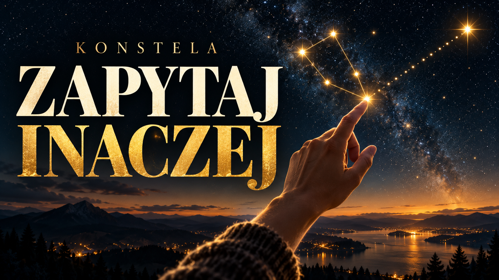
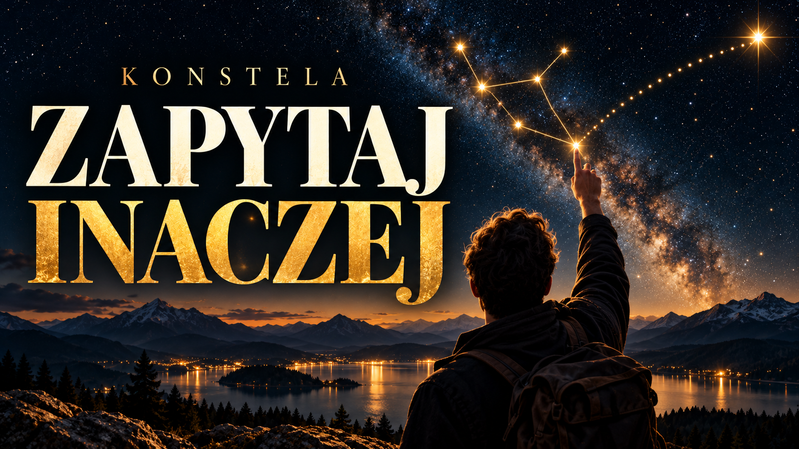

# Plebiscyt na piosenkę o sztucznej inteligencji

Otwarty konkurs na **własną piosenkę o sztucznej inteligencji i jej roli w świecie**: własny tekst, własna muzyka, własne wykonanie. Nie dajemy gotowego tematu ani gotowych słów - to, co w tym powiesz, jest częścią tego, co oceniamy.

**Zespoły i duety są jak najbardziej mile widziane.** „Własne" znaczy, że utwór jest wasz, a nie że jedna osoba musi zrobić wszystko: tekst może napisać ktoś inny niż ten, kto skomponował muzykę, i ktoś inny niż ten, kto śpiewa. Zgłoszenie wskazuje wtedy osobę reprezentującą cały skład, a sposób podziału nagrody pozostaje sprawą zgłaszających.

**Dla kogo.** Dla półprofesjonalistów: ludzi, którzy grają, śpiewają i piszą, mają już jakieś zasięgi, ale nie są gwiazdami.

## Na jakim to jest etapie

Mówię wprost, bo wolę to powiedzieć sam, niż żeby ktoś się domyślił. **Plebiscyt nie jest jeszcze ogłoszony.** Nie ma zabezpieczonych pieniędzy na nagrody, a ogłaszanie konkursu z nagrodami, których nie ma, byłoby dokładnie tym, czego w tym projekcie unikam.

Ta strona służy dziś jednej rzeczy: **zbieram zainteresowanie**. Jeśli napiszesz, trafisz na listę osób, które dowiedzą się pierwsze, gdy regulamin i nagrody będą gotowe. Nic to nie kosztuje i do niczego nie zobowiązuje żadnej ze stron.

Finansowania szukam w trzech miejscach naraz: w programach wsparcia kultury, u wydawnictw muzycznych i u sponsorów prywatnych. To osobna ścieżka od tej, którą idzie pula nagród w konkursie głównym.

## Jak to ma działać

**Jedno zgłoszenie na osobę**, potwierdzane kodem z SMS, tak samo jak przy zgłaszaniu rozmów. Limit dotyczy zgłoszeń, które reprezentujesz - w cudzych możesz brać udział jako współautor albo wykonawca bez ograniczeń, bo w muzyce granie u kilku osób naraz jest normą, a nie nadużyciem.

**Zgłoszenie.** Jedna piosenka: Twój tekst, Twoja muzyka, Twoje wykonanie. Temat jest szeroki - sztuczna inteligencja i to, co robi ze światem i z ludźmi - i celowo nie zawężam go bardziej. Zgłoszenia prezentowane są na stronie Nagrody w miarę, jak napływają.

**Wystarczy czytelne demo.** Nie wymagam gotowego singla i nie chcę, żeby ktokolwiek wydawał pieniądze na studio, nie wiedząc, czy cokolwiek wygra. Głos i instrument to dość, byle dało się usłyszeć tekst, melodię i wykonanie. **Profesjonalne nagranie jest po stronie organizatora i dopiero dla finalistów** - za utwór odpowiada autor, za jakość nagrania organizator. Jury dostaje przy tym wyraźne wskazanie, że ocenia utwór i wykonanie, a nie budżet realizacji.

**Muzykę i głos daje człowiek.** W konkursie o sztucznej inteligencji wygrywa człowiek, a nie generator. Granica jest jedna i stawiam ją wprost: **tekst, melodia, harmonia i wokal nie mogą być w żadnej części wygenerowane** - ani zwrotka, ani refren, ani partia wokalna. Nie chodzi więc o proporcje, tylko o to, że te cztery rzeczy są w całości ludzkie.

Narzędzia wolno natomiast używać **na etapie produkcji i obróbki**: korekta wysokości dźwięku, usuwanie szumu, separacja śladów, mastering, pomoc w brzmieniu. Przy zgłoszeniu deklaruje się, czego i do czego użyto.

Weryfikacja nie opiera się na tym, że jury rozpozna generator po odsłuchu, bo to byłoby zgadywanie. Podstawą jest Twoje oświadczenie, a finaliści mogą zostać poproszeni o materiały robocze - ślady, wersje, zapis pracy. Przy wątpliwości, której nie da się wyjaśnić, zgłoszenie zostaje w konkursie; dopiero wykazana nieprawda w oświadczeniu je wyklucza.

**Co ocenia jury.** Cztery kryteria, każde osobno. Poniżej projekt karty oceny - publikuję go już teraz, zamiast obiecywać kryteria na później, bo cała Nagroda stoi na tym, że wiadomo z góry, według czego się ocenia. **Ostateczne wagi uzgadnia jury**, a jego przewodniczący zna tę robotę lepiej niż ja.

| Kryterium | Punkty | Co znaczy |
|---|---:|---|
| Ujęcie tematu | 25 | Czy utwór mówi o życiu z AI coś niebanalnego, czy powiela dwa bieguny: strach przed maszyną albo zachwyt nad nią |
| Tekst | 30 | Język, obraz, konstrukcja; czy wers broni się także poza melodią |
| Muzyka | 25 | Melodia, harmonia, forma; czy utwór zostaje w głowie |
| Wykonanie | 20 | Wokal i interpretacja |
| **Razem** | **100** | |

Tekst ma najwyższą wagę, bo to konkurs, w którym oceniamy również pisanie. Wykonanie ma najniższą celowo: skoro przyjmuję dema, nie mogę wysoko ważyć czegoś, co zależy od tego, czy ktoś nagrywał w studiu, czy telefonem.

**Czego nie oceniamy: jakości produkcji, Twoich zasięgów ani wcześniejszego dorobku.** To jest ta sama zasada, na której stoi konkurs główny, gdzie oceniane są pytania człowieka, a nie odpowiedzi sztucznej inteligencji.

**Rozstrzygnięcie.** Zwycięzcę wybiera **jury**, nie głosowanie. Powód jest ten sam, dla którego cała Nagroda ocenia według jawnych kryteriów, a nie według popularności: przy głosowaniu wygrywa największy zasięg, a nie najlepsza piosenka. Przewodniczącym jury będzie **Michał Sołtan** - kompozytor, wokalista, gitarzysta i producent, półfinalista The Voice of Poland - który ten plebiscyt zaproponował.

**Nagroda publiczności.** Przyznawana osobno od werdyktu jury i wyraźnie nazwana, żeby jedno nie mieszało się z drugim. Są dwie: dla utworu z największą liczbą głosów oraz dla głosującego, który najlepiej uzasadni swój wybór. Głosuje się raz na numer telefonu, potwierdzony kodem z SMS - bez tego wygrywałby ten, kto ma znajomego programistę.

**Finał na gali.** Plebiscyt kończy się na tej samej gali co Nagroda za rozmowę. **Trzy najwyżej ocenione utwory wykonywane są na żywo**, a hymn Nagrody otwiera i zamyka wieczór. Pozostałe zgłoszenia żyją na stronie przez cały rok naboru.

**Nagrody.** Nagrody pieniężne dla czołowej trójki, dwie nagrody publiczności oraz statuetki - wysokość podam przy ogłoszeniu, gdy finansowanie będzie pewne. Osobno od pieniędzy: dziesięć najwyżej ocenionych utworów zostanie nagranych profesjonalnie w studiu, a nagrania mają ukazać się na **płycie wydanej przez wydawnictwo-partnera**. Płyta jest dla plebiscytu tym, czym antologia dla konkursu głównego: nie zdjęciem rękopisu, lecz porządnym wydaniem tego samego.

**Nagranie też zostaje Twoje.** Finansuję je, ale nie zostawiam sobie do niego praw i nie biorę procentu od tego, co zarobisz na streamingu czy na sprzedaży. Prawa do nagrania przechodzą na Ciebie jako część nagrody - to jest akurat rzecz, którą w umowach z wytwórniami oddaje się jako pierwszą, a tutaj jej nie oddajesz.

Powiem wprost, jak to jest finansowane, żeby nikt nie musiał się domyślać. **Koszt nagrań jest pozycją w budżecie konkursu, zabezpieczaną razem z nagrodami** - nie zależy więc od tego, czy znajdzie się wydawnictwo, ale zależy od uruchomienia samego konkursu, czyli od pozyskania sponsora. Nie finansuję tego z własnej kieszeni i nie udaję, że mam te pieniądze dziś. Takiego wydawnictwa też jeszcze nie mam; bez niego powstają nagrania, lecz nie powstaje wydanie płytowe. Prawa do nagrań i do utworów zostają przy ich autorach.

## Hymn Nagrody

Osobno od plebiscytu powstanie **hymn Nagrody Konstela** do napisanego przeze mnie tekstu „Zapytaj inaczej", nagrany przez **jurorów**, którzy biorą udział w nagraniu. Mówię o tym wprost, żeby nie było niejasności: jurorzy nie biorą udziału w plebiscycie i nie konkurują ze zgłoszeniami - wykonują utwór, który do konkursu nie wchodzi.

Hymn ma zostać nagrany i wydany na początku 2027 roku, bo jego premiera otwiera nabór, a na gali w 2028 wykonywany jest na żywo.

Tekst hymnu jest poniżej, razem z wersjami wygenerowanymi przez AI, żeby było wiadomo, o czym ta Nagroda jest i jakim mówi językiem.

## Prawa

Jedna zasada dla wszystkich zgłaszających: **wszystko zostaje Twoje**. Tekst, muzyka i nagranie pozostają Twoją własnością; możesz wydać utwór pod własnym nazwiskiem, grać go na koncertach i umieścić na swoich kanałach. Nie kupuję wyłączności i nie przejmuję niczyjej muzyki.

Nagroda potrzebuje prawa **niewyłącznego** i w trzech konkretnych zakresach, które wypisuję, zamiast zasłaniać się ogólnym „prezentacja": prezentacja zgłoszenia na stronie Nagrody w czasie naboru; wykonanie utworu na żywo podczas gali; oraz **utrwalenie gali na wideo i bezpłatne udostępnienie tego zapisu**, bo galę rejestrujemy i zapis publikujemy. Przy utworach, które wejdą na płytę, zakres wydania jest osobną sprawą i osobną umową między Tobą a wydawnictwem - Nagroda nie jest tu pośrednikiem. Całość przechodzi jeszcze przez kancelarię przed otwarciem naboru.

## Hymn: dwie wersje AI, trzecia ludzka

Zaczynamy od punktu, w którym dziś stoi każdy: tekst napisałem sam, a muzykę i wykonanie wygenerował generator suno.com. Dwie wersje, dwa podejścia do tych samych słów. Nie nazywam ich demem ani materiałem roboczym, bo nim nie są - to jest dokładnie to, co dzisiaj potrafi AI, i to jest nasz punkt wyjścia.

<table class="thumbs">
  <tr>
    <td>
      <a href="https://www.youtube.com/watch?v=3_Yc4dDPB2c" target="_blank" rel="noopener">
        
        Wersja AI 1 &middot; YouTube
      </a>
    </td>
    <td>
      <a href="https://www.youtube.com/watch?v=4qjqEl7EmoU" target="_blank" rel="noopener">
        
        Wersja AI 2 &middot; YouTube
      </a>
    </td>
  </tr>
</table>

Wkrótce dojdzie trzecia wersja: ten sam tekst nagrany przez jurorów plebiscytu, czyli przez ludzi z głosem, oddechem i własną decyzją w każdej frazie. Wtedy wszystkie trzy staną obok siebie na tej stronie i każdy będzie mógł je przesłuchać, porównać i ocenić sam.

I o to w tym chodzi. Nie o to, żeby wykazać, że AI jest gorsza, bo w paru rzeczach już nie jest. O to, żeby usłyszeć na własne uszy, co dokłada człowiek, kiedy wchodzi w tę samą piosenkę - i czy to słychać. Ta sama różnica decyduje w głównej Nagrodzie, tyle że tam dotyczy rozmowy zamiast dźwięku.

Tekst jest zapisany w rodzaju męskim, ale odmienia się bez straty dla rytmu - szukałam, wiedziałam.

> **[Zwrotka 1]**
>
> Mam w kieszeni wszystkie fakty świata,
> każdy z nas je ma od wielu lat.
> Leżą luzem, nie układa ich nikt,
> milion kropek i ani jednej nici.
>
> **[Zwrotka 2]**
>
> Pytam źle, więc wraca gładka odpowiedź,
> pytam lepiej i zaczyna się ruch.
> Nie szukałem gotowej prawdy,
> tylko miejsca, gdzie pęka mój słuch.
>
> **[Refren]**
>
> Gwiazdy nie wiedzą, że są konstelacją,
> dopóki ktoś nie poprowadzi linii.
> Nie liczy się ten, kto odpowiada,
> tylko ten, kto zapyta inaczej.
>
> **[Zwrotka 3]**
>
> Była druga w nocy, nie było olśnienia,
> było trzydzieści pytań i jedno "a gdyby".
> I nagle wszystko, co wiedziałem wcześniej,
> ułożyło się w kształt, którego nie było.
>
> **[Most]**
>
> Maszyna mówi pięknie i pewnie,
> pięknie i pewnie potrafi się mylić.
> Więc sprawdzam, drążę, nie wierzę od razu,
> bo to ja mam z tym zostać, nie ona.
>
> **[Refren]**
>
> Gwiazdy nie wiedzą, że są konstelacją,
> dopóki ktoś nie poprowadzi linii.
> Nie liczy się ten, kto odpowiada,
> tylko ten, kto zapyta inaczej.
>
> **[Zakończenie]**
>
> Zapisz tę rozmowę, zostaw po sobie ślad.
> Ktoś za dziesięć lat przeczyta, jak myślał ten świat.

## Dlaczego w ogóle o tym śpiewać

Rozmowa z AI jest dziś codziennością milionów ludzi i jedną z niewielu rzeczy, które naprawdę zmieniły sposób, w jaki myślimy, a w muzyce popularnej nie ma jej prawie wcale. To, co jest, rozkłada się na dwa bieguny: strach przed maszyną albo zachwyt nad nią. Mało kto śpiewa o tym, co dzieje się naprawdę, czyli o człowieku siedzącym w nocy przed ekranem i próbującym zadać lepsze pytanie.

Dlatego temat plebiscytu jest szeroki i dlatego nie podaję gotowych słów. Interesuje mnie, co o tym macie do powiedzenia, a nie dwadzieścia wersji jednego zdania.

## O czym jest Nagroda Konstela

Coroczna, ogólnopolska nagroda dla ludzi, którzy prowadzą najlepsze rozmowy ze sztuczną inteligencją. Nagradzany jest człowiek, a nie AI, bo oceniane są pytania, a nie odpowiedzi. Rzecz jest jednak szersza niż same rozmowy: chodzi o życie z AI, o współistnienie ludzi i sztucznej inteligencji w epoce, która już się zaczęła. Rozmowa jest pierwszym miejscem, w którym to widać; muzyka jest drugim, i dlatego plebiscyt nie jest tu dodatkiem. Najlepsze rozmowy ukażą się w bezpłatnej antologii, a szerszy zbiór trafi do publicznego archiwum. Regulamin i karta oceny są jawne od pierwszego dnia; strona jest w wersji roboczej, docelową przygotuje agencja kreatywna.

Organizatorem będzie Fundacja Konstela, powoływana wyłącznie w tym celu; jej rejestracja jest w toku.

## Kontakt

Krzysztof Olbiński
+48 503 520 004
olbinski@gmail.com

Napisz, jeśli chcesz być na liście albo jeśli masz pytania. Jeśli to nie dla Ciebie, a znasz kogoś, kto powinien o tym wiedzieć, polecenie też jest pomocą.

[Strona główna Nagrody](/)
