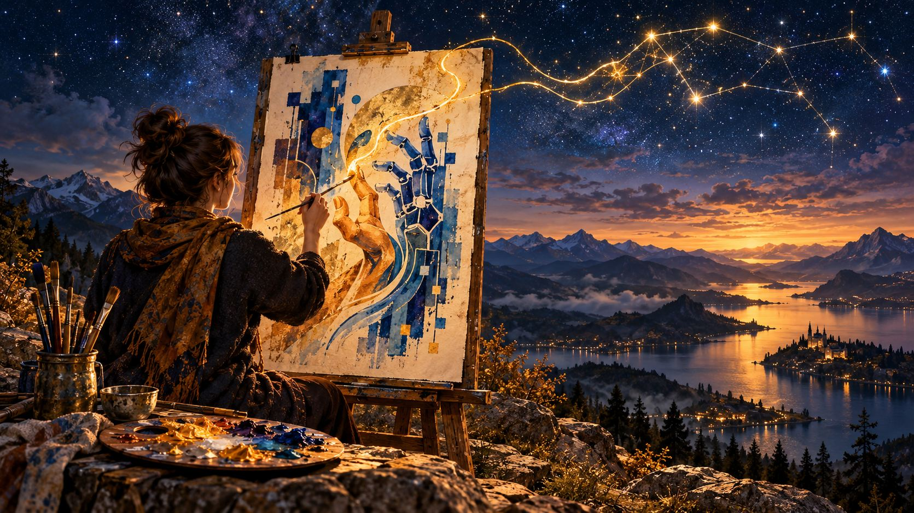

# Plebiscyt na plakat o sztucznej inteligencji

Edycja pierwsza &middot; 2027

<!--ikona:rozdzielacz-->

## <!--ikona:plakat-->Co to za plebiscyt

Plebiscyt na **plakat o sztucznej inteligencji i jej roli w świecie**, wykonany ręcznie: farbą, tuszem, kolażem, dowolną techniką tradycyjną. Jeden warunek: **obraz ma powstać pod ludzką ręką**.

**Zwycięski plakat zostaje graficzną twarzą edycji.** Trafia na galę, do mediów i **na okładkę [Antologii](/#co-zostaje-po-edycji)** – książki z najlepszymi rozmowami z AI, którą Nagroda wydaje co roku.

**W skrócie:**

- **o nagrodach głównych decyduje jury, a nie liczba głosów**: przyznaje [nagrodę](#nagrody) główną, nagrody za drugie i trzecie miejsce oraz siedem wyróżnień
- **publiczność ma własną [Nagrodę Publiczności](#nagroda-publicznosci)**, niezależną od werdyktu jury
- zgłaszasz **zdjęcie albo skan** pracy, nie oryginał
- **zgłaszasz dwa pliki: zdjęcie całej pracy i zdjęcie jednego fragmentu w zbliżeniu** - zbliżenie nie jest osobno oceniane; jest po to, żeby dało się zobaczyć materię pracy, której ze zdjęcia całości widać nie sposób
- **do zgłoszenia dołączasz nagranie z pracy nad plakatem, co najmniej 3 minuty, ze swoją widoczną twarzą** – zaplanuj je, zanim zaczniesz malować
- jury wybiera **dziesięciu finalistów** i ogłasza ich przed galą; na wystawie przy gali wisi **wydruk wystawowy** Twojej pracy, który wykonujemy my, a oryginał zostaje u Ciebie
- **werdykt zapada przed galą**, a publicznie ogłaszamy go dopiero na sali
- zwycięska praca trafia na okładkę **[Antologii](/#co-zostaje-po-edycji)** – zgoda na to jest warunkiem udziału, a formę okładki uzgadniamy z autorem
- wszystkie zgłoszenia trafiają do **[Galerii](#galeria-i-archiwum)**, a po werdykcie do publicznego **[Archiwum](#archiwum)**
- **pracę wolno sprzedać**: w zgłoszeniu możesz podać link do własnej aukcji, a finaliści mogą dodatkowo wejść w cichą licytację przy wystawie w galerii – [obie drogi są dobrowolne](#sprzedaz-pracy-dwie-drogi-obie-dobrowolne)
- zgłaszasz **jedną pracę w jednej edycji**
- nabór zamykamy **pod koniec listopada 2027**, wcześniej niż nabór rozmów i piosenek, bo Antologia musi zdążyć do druku; nabór zamyka się także wcześniej, jeżeli wpłynie **250 zgłoszeń** (§ 3a ust. 4 regulaminu), a limit ogłaszamy w dniu otwarcia naboru

## <!--ikona:etap-->Na jakim etapie jest ten plebiscyt

**Plebiscyt nie jest jeszcze ogłoszony.** Nabór planujemy otworzyć **w 2027 roku**, po zabezpieczeniu finansowania, a terminy w harmonogramie są planem, nie zobowiązaniem.

**Wysokość nagród zależy od pozyskanych sponsorów.** Podamy ją w dniu otwarcia naboru i od tej chwili pula może już tylko rosnąć – plebiscytu z nagrodami, których nie ma, nie ogłaszamy. Skład jury i Akademii ogłaszamy przed naborem.

**Ta strona służy dziś jednej rzeczy: zbieramy zainteresowanie.** Jeśli [napiszesz do nas](#kontakt), trafisz na listę osób, które dowiedzą się pierwsze, gdy nabór ruszy. Nic to nie kosztuje i do niczego nie zobowiązuje żadnej ze stron; **dziś nie przesyłasz ani pracy, ani danych do zgłoszenia**.

## <!--ikona:konstelacja-->Dlaczego akurat plakat

Ilustracja i plakat to pierwsze zawody, w których z dnia na dzień dało się wygenerować w AI obraz zamiast go zlecić. Spór o to, co z tego wynika, toczy się w tym środowisku od dawna i nie nam go rozstrzygać – **stawiamy tylko po jednej stronie konkretną propozycję**: praca ma powstać pod ludzką ręką. Nie dlatego, że generator rysuje źle – dlatego, że chcemy zobaczyć, **co masz do powiedzenia o tej maszynie**, kiedy mówisz to własną ręką. Temat i stanowisko wybierasz sam.

**Nie pytamy o dorobek, dyplomy ani galerie** – zgłasza się zdjęcie pracy, nie życiorys.

## <!--ikona:uczestnik-->Kto i co może zgłosić

### Kto może zgłosić

**Wiek: od 16 lat.** Osoba, która nie ukończyła 18 lat, potrzebuje zgody opiekuna prawnego na udział, na przesłanie nagrania z widoczną twarzą oraz na obowiązkowe zakresy licencji. Zgody dotyczące pozostałych form wykorzystania pracy – odbioru nagrody, wysyłki oryginału, udziału w gali – rozpatrywane są osobno i ich brak wyklucza tylko z tej jednej rzeczy.

**Pracę wykonaną wspólnie zgłasza jedna osoba reprezentująca cały skład** – prowadzi korespondencję i odbiera nagrodę, a podział pozostaje sprawą autorów. Nagranie z pracy ma wtedy pokazać każdego ze współautorów.

**Dla kogo.** Szczególnie zapraszamy twórców rozwijających własną praktykę – ilustratorów, malarzy, studentów szkół artystycznych, projektantów. Dorobek nie jest oceniany.

### Co możesz zgłosić

Temat jest szeroki – sztuczna inteligencja i to, co robi ze światem i z ludźmi – i celowo nie zawężamy go bardziej. Nie podajemy ani hasła, ani układu, ani tego, czy plakat ma być pochwałą AI, czy ostrzeżeniem przed nią.

### Wymogi formalne

**Bez nich zgłoszenie jest odrzucane jeszcze przed oceną [Akademii](#kto-ocenia) i [jury](#kto-ocenia):**

- praca jest **wykonana ręcznie**, techniką tradycyjną, a nie wygenerowana ani domalowana cyfrowo na wygenerowanym podkładzie
- format **pionowy**, dłuższy bok od 50 do 150 cm, proporcje w zakresie od 1:1,2 do 1:1,6
- praca **nie była publikowana w wydawnictwie, wystawiana ani nagradzana w innym plebiscycie przed dniem zgłoszenia** – liczy się stan na ten dzień, a pokazanie pracy na własnym profilu niczego nie blokuje
- zdjęcie albo skan ma **czytelną jakość**: cała praca w kadrze, bez odblasków i bez widocznego rozmycia

## <!--ikona:ogniwo-->Jak możesz się zgłosić

### Jedno zgłoszenie na osobę

Zgłoszenie potwierdzamy **jednorazowym kodem z SMS**: na jeden numer telefonu przypada jedno zgłoszenie w edycji. Numeru nie przechowujemy w postaci jawnej i nie pokazujemy go nigdzie publicznie.

### Dlaczego warte nagrody głównej, czyli co sprawia, że warto zatrzymać się przy tej pracy

W zgłoszeniu wypełniasz pole tekstowe **do 700 znaków**: **co sprawia, że warto zatrzymać się przy tej pracy**. Tekst ten **nie podlega ocenie** w żadnym kryterium, ale jest widoczny publicznie przy Twoim zgłoszeniu: w [Galerii](#galeria-i-archiwum) w czasie naboru i w Archiwum po werdykcie.

### Kontakt do autora

**Link do Twojej strony albo profilu – nieobowiązkowo.** Możesz podać adres swojej strony albo profilu w wybranym przez siebie serwisie; pokażemy go przy Twoim zgłoszeniu w [Galerii](#galeria-i-archiwum) i w [Archiwum](#archiwum). Nie wpływa on na ocenę Akademii i jury, a usuniemy go albo zmienimy na Twoją prośbę w ciągu 14 dni. Jeżeli podpisujesz zgłoszenie pseudonimem, pamiętaj, że taki link może pozwolić ustalić Twoją tożsamość – decyzja należy do Ciebie.

### Link do własnej sprzedaży

**Link do aukcji albo oferty sprzedaży pracy i data jej zakończenia – nieobowiązkowo.** Jeżeli wystawiasz pracę na sprzedaż, podaj link i datę; pokażemy je przy Twoim wpisie w [Archiwum](#archiwum) do tej daty. Nie pośredniczymy w sprzedaży i nie bierzemy z niej nic – szczegóły opisuje sekcja o [sprzedaży pracy](#sprzedaz-pracy-dwie-drogi-obie-dobrowolne).

### Zdjęcie pracy, nagranie i materiały

**Przesyłasz dwa pliki: zdjęcie albo skan całej pracy oraz zdjęcie jednego fragmentu w zbliżeniu.** Fragment wybierasz sam - nie więcej niż jedna czwarta dłuższego boku pracy, prostopadle do powierzchni, w świetle rozproszonym, bez wyostrzania i bez obróbki zmieniającej fakturę albo barwę. Zbliżenie nie jest osobno oceniane i nie oglądamy go jako kompozycji: jest po to, żeby w kryterium Wykonanie dało się zobaczyć materię pracy - prześwit, krawędź, ślad narzędzia - czego ze zdjęcia całości zobaczyć nie sposób. Jeżeli to, co w materii pracy niesie znaczenie, widać już na zdjęciu całości, najwyższe pasma Wykonania są osiągalne także bez zbliżenia - **zbliżenie służy wykazaniu, nie dopuszczeniu**. I **brak zbliżenia nie odrzuca zgłoszenia**: poprosimy o uzupełnienie.

**Oryginału nie wysyłasz na galę.** Na wystawie towarzyszącej gali wisi wydruk wystawowy w rozmiarze oryginału, z tytułem i Twoim podpisem; wykonujemy go my. Oryginał prosimy przysłać tylko w dwóch sytuacjach: jeżeli jury poprosi o **oględziny**, bo nagranie z pracy i dokumentacja nie rozstrzygają, czy plakat jest wykonany ręcznie, albo jeżeli dojdzie do **wystawy w galerii sztuki po gali** - a ta zależy od pozyskania galerii i od Twojej zgody. Przy oględzinach żądanie jury jest pisemne, wskazuje powód i daje Ci termin nie krótszy niż 21 dni. Przy wystawie w galerii tamten termin nie obowiązuje, ale pisemne uzgodnienie okresu jest potrzebne w obu wypadkach: bez niego nie zlecamy przewoźnikowi odbioru pracy - z datą końcową, kosztami i zakresem ubezpieczenia. W obu wypadkach opakowanie, przesyłkę w obie strony i ubezpieczenie pokrywa organizator. Jeśli nie chcesz wysyłać oryginału, nie tracisz ani nagrody, ani miejsca w werdykcie – jury oceni wtedy pracę ze zdjęcia, nie obniżając punktacji z tego powodu.

### Dokumentacja procesu twórczego

Nagranie pomaga potwierdzić sposób powstawania pracy i ogranicza ocenianie autorstwa na podstawie samego wyglądu plakatu. Ocena „czy to wygląda na wygenerowane” byłaby zgadywaniem i uderzałaby w tych, którzy malują gładko i precyzyjnie. Pomyśl o nagraniu **przed rozpoczęciem pracy**. Musi trwać co najmniej 3 minuty, ale nie wymagamy profesjonalnej jakości obrazu, dźwięku ani montażu. Nagrania nie publikujemy; udostępniamy je wyłącznie oceniającym i jury.

**Dołączasz nagranie z pracy nad plakatem, co najmniej 3 minuty.** Jest obowiązkowe. Fragmenty pokazujące pracę mają obejmować w jednym kadrze Twoją twarz, pracę oraz dłoń podczas jej wykonywania, na co najmniej dwóch etapach, w tym takim, na którym plakat jest już rozpoznawalny. **Jedno ujęcie musi być nieprzerwanym przejściem kamery od Twojej twarzy do wykonywanej pracy**, bez cięcia – to ono wiąże Ciebie z tą konkretną robotą. Nagranie może składać się z kilku ujęć, byle każde trwało minutę i nie było w nim cięć. Przyspieszone ujęcia możesz dołączyć, ale do tych 3 minut się nie liczą.

**Najprościej ustawić telefon na statywie albo oprzeć go o coś z boku**, tak żeby w kadrze mieściły się naraz Twoja twarz, praca i ręka. Twarz nie musi być duża ani ostra – ma pozwolić rozpoznać, że pracuje ta sama osoba, która zgłasza pracę. Jeżeli pracujesz w dużym formacie i wszystko nie mieści się w jednym kadrze, odsuń kamerę albo nagraj z boku pod kątem.

**Czego nagranie nie musi mieć.** Twojego głosu, montażu, dźwięku, dobrej kamery ani całego czasu pracy. Nie wymagamy profesjonalnego sprzętu. Nagranie nie jest oceniane w żadnym kryterium. Nie publikujemy go nigdzie – ani w Galerii, ani w Archiwum – i udostępniamy je wyłącznie oceniającym i jury. Twarz na nagraniu nie odbiera Ci możliwości zgłoszenia pracy pod pseudonimem: publicznie podpisujemy pracę tak, jak wskażesz.

**Jak je przesłać.** Podajesz link do nagrania na YouTube – może być niepubliczny. Pamiętaj tylko, że film niepubliczny w YouTubie może obejrzeć każdy, kto ma do niego link.

Formularz zgłoszeniowy pojawi się na naszej stronie w dniu ogłoszenia naboru. Możesz [dodać swój e-mail](#kontakt), by zostać powiadomionym o rozpoczęciu naboru zgłoszeń.

## <!--ikona:zasady-->Zasady: ręka, nie generator

**Obraz ma powstać pod ludzką ręką.** Możesz używać generatora do poszukiwań, zanim weźmiesz pędzel – napisz tylko w zgłoszeniu, do czego go użyłeś. Nie możesz natomiast odtwarzać wygenerowanego obrazu ani jego istotnej części – w tym charakterystycznej kompozycji – przez kalkowanie, przerysowanie, przemalowanie albo domalowanie na wydrukowanym podkładzie. Samo podobieństwo tematu, stylu albo palety barw nie przesądza o naruszeniu.

**Deklaracja zamiast zakazu na etapie poszukiwań.** Każde zgłoszenie zawiera krótką deklarację: z jakich narzędzi generatywnych korzystałeś, szukając odniesień, układu albo nastroju – albo że nie korzystałeś z żadnych. Deklaracja jest publikowana razem z pracą i **nie wpływa na ocenę**: jury nie dostaje za nią ani punktu więcej, ani mniej. Pytamy dlatego, że zakaz, którego nie dałoby się sprawdzić, karałby wyłącznie tych, którzy mówią prawdę.

Granica jest tu twardsza niż przy piosence, gdzie tekst wolno napisać z AI – bo przy plakacie to właśnie obraz jest ocenianym wytworem, a nie jednym z kilku składników.

**Jak to sprawdzamy.** Nie przez rozpoznawanie generatora na oko, bo to byłoby zgadywanie. Podstawą jest nagranie z pracy nad plakatem i Twoje oświadczenie, a jeżeli to nie wystarczy, jury prosi finalistę o oryginał do oględzin. Przy wątpliwości, której nie da się wyjaśnić, zgłoszenie zostaje w plebiscycie; dopiero wykazana nieprawda w oświadczeniu je wyklucza.

**Narzędzia cyfrowe przy przygotowaniu pliku** – kadrowanie, korekta kolorów do zgodności z oryginałem, usunięcie cienia – są dozwolone i oczywiste. Nie wolno nimi dodawać ani usuwać elementów obrazu.

## <!--ikona:kryteria-->Kryteria oceny

<article>
<h3>Ujęcie tematu – od 0 do 30 punktów</h3>

<strong>Co mówisz</strong> o życiu z AI: trafność, oryginalność i głębia wypowiedzi.

</article>
<article>
<h3>Pomysł plastyczny – od 0 do 30 punktów</h3>

<strong>Jak to pokazujesz</strong>: przełożenie myśli na obraz, metaforę i relacje między elementami. Niżej punktowane jest banalne użycie motywu, a nie sam motyw.

</article>
<article>
<h3>Wykonanie – od 0 do 20 punktów</h3>

Świadome użycie techniki, koloru i rysunku. Najwyższe pasma dotyczą tego, czy materia pracy <strong>wnosi do wypowiedzi znaczenie, którego nie wnosi sam układ</strong> – na przykład czy sposób, w jaki farba wchodzi w podłoże, czyni z zatarcia twarzy proces, a nie stan. Dlatego prosimy o zdjęcie fragmentu w zbliżeniu.

</article>
<article>
<h3>Działanie plakatu – od 0 do 20 punktów</h3>

Czy wypowiedź pracy jest nośna z odległości i w pomniejszeniu – sprawdzamy to na pomniejszeniu Twojej reprodukcji do 18 milimetrów dłuższego boku, czyli do skali miniatury w Galerii i znaczka na okładce. Oceniamy je <strong>zaczynając od miniatury</strong>, przed obejrzeniem dużego zdjęcia – inaczej wypowiedź odczytuje się z pamięci dużego obrazu, a nie z samej miniatury. <strong>To jedyne kryterium z progiem</strong>: praca, która go nie osiągnie, nie wchodzi do dziesiątki finalistów, bo to plebiscyt na plakat. Próg ogłaszamy w dniu otwarcia naboru i nie będzie niższy niż 12 na 20 punktów.

</article>

**Razem maksymalnie 100 punktów.**

Dwa pierwsze kryteria ważą najwięcej, ale mierzą różne rzeczy: **ujęcie tematu to „co mówisz”, pomysł plastyczny to „jak to pokazujesz”**. Można mieć trafną myśl i rozwiązać ją nijak, albo olśniewająco pokazać coś, co nic nie wnosi. Wykonanie waży mniej celowo: nie szukamy najlepszego warsztatu, tylko najlepszego plakatu.

**Znany motyw nie jest wadą.** Robot, oko, sieć połączeń – wszystkiego tego wolno użyć i da się użyć znakomicie. Ocenę obniża dopiero rozwiązanie ograne: motyw użyty tak, jak widzieliśmy go już sto razy.

**Czego nie oceniamy: Twojego dorobku, wykształcenia ani tego, czy ktoś Cię już wystawiał.**

**Jak liczymy wynik.** W pierwszym przejściu punkty zgłoszenia to średnia ocen osób z Akademii, które je oglądały – i z tego powstaje lista dla jury. Wśród finalistów decyduje średnia ocen jury. Jeżeli ktoś z jury wyłącza się od oceny Twojej pracy, bo Cię zna, jego ocena nie jest brana pod uwagę.

Wszystkie szczegóły określa [regulamin](/dokument/regulamin-plakatu), a [karta oceny](/dokument/regulamin-plakatu#karta-oceny) wyjaśnia dokładnie, co znaczy każde pasmo punktowe w każdym kryterium, i jest jawna przed naborem.

<h2 id="kto-ocenia"><!--ikona:jury-->Kto ocenia</h2>

<article>
<h3>Akademia plakatu</h3>

<strong>Wszystkie zgłoszenia, które przeszły weryfikację formalną, ogląda Akademia plakatu</strong> – grono praktyków plakatu, ilustracji i projektowania graficznego, powoływane w każdej edycji. Ocenia tą samą <a href="/dokument/regulamin-plakatu#karta-oceny">kartą oceny</a> co jury i przekazuje mu listę wyłonioną według zasad ogłoszonych przed naborem: ile osób ogląda jedno zgłoszenie i jak powstaje lista, mówimy przed otwarciem naboru.

</article>
<article>
<h3>Jury</h3>

<strong>Jury wybiera dziesięciu finalistów i ustala kolejność całej dziesiątki.</strong> Członek jury i członek Akademii wyłącza się od oceny pracy, której autora zna na tyle, że mogłoby to wpłynąć na ocenę.

</article>

### Co, jeżeli zgłoszeń będzie bardzo dużo

Akademia to opłacani oceniający, a ich liczba ma granicę. Dlatego regulamin przewiduje **rundy uczestników**: pierwszą kwalifikację zgłoszeń przeprowadzają wtedy sami uczestnicy, a wchodzi to w życie tylko w edycji, w której zgłoszeń jest więcej, niż Akademia może obejrzeć. **W pierwszej edycji rund uczestników nie będzie.** Jeżeli miałyby się odbyć, powiemy o tym **w dniu ogłoszenia naboru** – razem ze wszystkimi parametrami i z terminami edycji, które uwzględniają czas ich przeprowadzenia. Nie wprowadzamy ich i nie wycofujemy w trakcie naboru, a parametrów nie zmieniamy.

Gdyby runda uczestników się odbywała, wyglądałoby to tak:

- **warunkiem rozpatrzenia Twojego zgłoszenia jest obejrzenie i ocenienie do ośmiu cudzych prac** w rundzie, do której trafiło. W przydziale są jeszcze **zgłoszenia wzorcowe** ocenione wcześniej – nie wiesz które – po to, żeby dało się zmierzyć, jak oceniasz. Przydziały są losowe i ślepe: nie wybierasz, co oceniasz, i nie wiesz, kto to zrobił
- **przydział jest tu dwa razy większy niż w pozostałych plebiscytach** – do ośmiu prac zamiast czterech – bo obejrzenie plakatu zajmuje ułamek czasu potrzebnego na rozmowę czy utwór. Większy przydział daje każdej pracy więcej niezależnych ocen, a Ciebie obciąża tyle samo. Oceniasz **plik zgłoszeniowy**, nie oryginał - tak samo jak Akademia i jury, które też oceniają z reprodukcji, a oryginał wzywają tylko przy wątpliwości co do ręcznego wykonania
- **każde zgłoszenie dostaje co najmniej trzy oceny**, a te, którym zabrakło oceniających, dobierają ich w kolejnym przydziale. Żadne zgłoszenie nie wypada z powodu braku oceniających
- oceniasz **tą samą jawną kartą oceny**, co Akademia i jury, z uzasadnieniem przy każdym kryterium; nie ma osobnych, tajnych kryteriów. **Nie sprawdzamy, czy Twoja ocena jest słuszna** – niska albo wysoka punktacja nie jest powodem odrzucenia
- na ocenę masz **14 dni**, przypominamy dwa razy, a **jedno przydzielone zgłoszenie możesz odrzucić** bez podawania powodu; zastępcze ma zbliżoną formę, żeby odmowa nie służyła do dobierania sobie przydziału
- **przydzielonych zgłoszeń nie wolno kopiować, publikować ani udostępniać** – ani w czasie edycji, ani potem
- jeżeli nie ocenisz, Twoje zgłoszenie nie przechodzi do dalszych rund; w uzasadnionych przypadkach (choroba, zdarzenie losowe, brak zgody opiekuna u osoby niepełnoletniej) obejrzenia przejmuje Akademia, a zgłoszenie idzie dalej
- **jeżeli nie wykona ich dość dużo osób, runda nie zawęża pola** – ogłaszamy z góry, jaki odsetek runda musi osiągnąć, a poniżej tego progu pole zawęża Akademia własnym trybem
- oceny uczestników **nie przyznają nagród i nie są werdyktem**: służą tylko do tego, które zgłoszenia trafią do opłacanej Akademii – a Akademia ocenia je **od nowa, nie znając Twoich ocen**

Reguły są wspólne dla wszystkich czterech plebiscytów i opisane w jednym miejscu, żeby nie rozeszły się ze sobą: w [regulaminie rozmowy](/dokument/regulamin-rozmowy), w § 8 ust. 10c, wraz z [wyjaśnieniem całej konstrukcji](/dokument/skalowanie-oceny). Tutejsze odrębności i parametry są w [regulaminie](/dokument/regulamin-plakatu), w § 8 ust. 4m i 4n.

### Dzika karta

Uśredniona ocena potrafi odrzucić zgłoszenie nietypowe – takie, które część oceniających postawi wysoko, a część nisko. Dlatego **każdy członek Akademii może raz w edycji skierować jedno zgłoszenie do obowiązkowego niezależnego obejrzenia**, wykonywanego przez kogoś innego, kto nie zna dotychczasowego wyniku ani uzasadnienia karty. Jeżeli to obejrzenie potwierdzi wartość zgłoszenia, wchodzi ono do oceny jury **ponad zwykłą liczbę miejsc**, przez osobną pulę, której wielkość ogłaszamy przed naborem. **Dziesiątki finalistów pula nie powiększa** – bo finał to miejsce na wystawie i czas jury, a tego nie da się skalować razem z liczbą zgłoszeń. Karta nie wypiera więc nikogo z listy. Liczbę złożonych kart i liczbę zgłoszeń, które dzięki nim awansowały, podajemy w podsumowaniu edycji.

<h2 id="nagrody"><!--ikona:puchar-->Nagrody</h2>

<article>
<h3>Nagroda główna</h3>

Nagroda pieniężna, medal, dyplom i miejsce na wystawie.

</article>
<article>
<h3>Nagroda za drugie i trzecie miejsce</h3>

Nagrody pieniężne dla dwóch kolejnych prac z werdyktu jury, dyplomy i miejsce na wystawie.

</article>
<article>
<h3>Siedem wyróżnień</h3>

Dla pozostałych finalistów: dyplom i miejsce na wystawie towarzyszącej gali. Z wyróżnieniem nie wiąże się nagroda pieniężna.

</article>
<article>
<h3 id="nagroda-publicznosci">Nagroda Publiczności</h3>

<strong>Otwarte głosowanie, niezależne od werdyktu jury</strong>, dla zgłoszenia z największą liczbą głosów. Jeden głos na numer telefonu, potwierdzony kodem z SMS, od 16 lat; nie głosują autorzy zgłoszeń tego plebiscytu. Liczniki i uzasadnienia są ukryte do gali. Głosowanie rusza po ogłoszeniu ostatecznej listy zakwalifikowanych zgłoszeń i kończy się w dniu gali o 12:00.

</article>
<article>
<h3>Nagroda dla publicznych ocen zgłoszonych plakatów</h3>

Nagroda nie dla zgłaszającego, lecz <strong>dla osoby głosującej</strong>. Przy każdym głosie na <a href="#nagroda-dla-publicznych-ocen-zgloszonych-plakatow">najlepszy według Ciebie plakat</a> piszesz swoje uzasadnienie, a najlepsze wybiera zespół spoza jury.

</article>

### Okładka Antologii

**Okładka jest zapowiedzianą częścią tego plebiscytu, więc zgoda na nią jest warunkiem udziału.** Zgłaszając pracę, wiesz, że jeśli wygrasz, znajdzie się ona na okładce Antologii, z Twoim nazwiskiem albo pseudonimem na stronie redakcyjnej. Antologia jest bezpłatnym e-bookiem, a po pozyskaniu wydawnictwa także wydaniem książkowym; okładką jest Twoja praca w obu wersjach.

**Formę okładki uzgadniamy z Tobą.** Zaraz po werdykcie, czyli przed galą, dostajesz propozycję kadru i typografii, a na uwagi masz 7 dni. Praca jest oceniana jako plakat, a nie jako zlecenie na projekt okładki, więc nie oczekujemy od Ciebie poprawek. **Jeżeli nie dojdziemy do porozumienia co do formy, okładką zostaje reprodukcja całej pracy bez kadrowania**, a tytuł i pozostałe napisy umieszczamy poza polem obrazu. Dzięki temu z góry wiesz, jak praca ukaże się przy braku uzgodnienia, a Antologia zdąży do druku. Twoje autorskie prawa osobiste, w tym prawo do nienaruszalności formy, zostają przy Tobie.

### Wystawy

**Wystawa przy gali.** Prace całej dziesiątki finalistów są pokazywane podczas gali rozstrzygnięcia Nagrody w postaci **wydruków wystawowych** w rozmiarze oryginału. Oryginały zostają u autorów, więc nic nie jedzie, nie czeka w magazynie i nie może się po drodze zniszczyć. Jeżeli oryginał trafia do nas - na oględziny albo na wystawę w galerii - opakowanie, przesyłkę w obie strony, przechowywanie i ubezpieczenie pokrywa organizator. **Po oględzinach praca wraca do Ciebie w ciągu 30 dni od ich zakończenia**, przy czym liczy się rzeczywisty powrót pracy, a nie dzień nadania przesyłki zwrotnej. Dostajesz przy tym dwie daty dla swojej pracy z góry - dzień odbioru i dzień zwrotu - i wiążą nas one; ich zmiana wymaga Twojej pisemnej zgody. **Każdy okres, w którym praca zostaje u nas, ma własną granicę 75 dni** liczoną od dnia odebrania pracy od Ciebie, i każdy wymaga wcześniejszego pisemnego uzgodnienia z datą końcową, kosztami i zakresem ubezpieczenia - bez tego nie zlecamy przewoźnikowi odbioru pracy.

**Wystawa w galerii sztuki – jeżeli znajdziemy galerię.** Chcemy pokazać po gali **oryginały** prac finałowych, na wystawie otwieranej wernisażem – już z informacją o miejscach przyznanych przez jury. To jedyne miejsce, w którym oryginały są pokazywane publicznie. **Nie obiecujemy tego w regulaminie**, bo zależy to od pozyskania galerii. Jeżeli się uda, dostaniesz pisemną propozycję z miejscem, terminami, zakresem ubezpieczenia, czasem pozostawania pracy u nas i sposobem zwrotu, a przy wystawie może się odbyć cicha licytacja. Propozycję przedstawiamy finalistom w kolejności z werdyktu, a liczbę prac wyznacza przestrzeń galerii. Możesz jej nie przyjąć – nie tracisz przez to ani nagrody, ani miejsca na wystawie przy gali, a oryginał po prostu zostaje u Ciebie.

<h2 id="nagroda-dla-publicznych-ocen-zgloszonych-plakatow"><!--ikona:tekst-->Nagroda dla publicznych ocen zgłoszonych plakatów</h2>

**Oddając głos w Nagrodzie Publiczności, uzasadniasz swój wybór** – od 200 do 1500 znaków, czyli od dwóch zdań do krótkiego akapitu, przy samym głosie. Bez uzasadnienia głos nie zostaje oddany. Zależy nam, aby to głosowanie było wyborem przemyślanym, a nie akcją zasięgową.

**Twoje uzasadnienie możemy pokazać przy zgłoszeniu, na które głosowałeś** – jeżeli się zgodzisz. Zgoda jest nieobowiązkowa, można ją wycofać, a jej brak nie wyłącza uzasadnienia z oceny ani głosu z liczenia. Podpisujemy je tak, jak wskażesz: imieniem albo pseudonimem.

**Uzasadnienia pokazujemy dopiero po gali**, razem z wynikiem głosowania – inaczej liczba komentarzy pod zgłoszeniem mówiłaby o jego popularności dokładnie tyle, co ukryty licznik.

### Wybór najlepszego uzasadnienia

**Jeżeli uzasadnień będzie bardzo dużo, zespół przeczyta wylosowaną próbę - i mówimy o tym, zanim zagłosujesz, a nie po.** Liczbę uzasadnień objętą oceną ogłaszamy przed otwarciem głosowania; przy tej liczbie i niżej czytane są wszystkie. Powyżej niej nagradzane jest najlepsze uzasadnienie **spośród wylosowanych**, co znaczy, że część tekstów nie zostanie przeczytana. Każde uzasadnienie ma w losowaniu **jednakową szansę** - nie zależy ona od tego, na który plakat zagłosowałeś ani kiedy.

**Losowania nie da się ustawić i każdy może je powtórzić.** Najpierw zamykamy głosowanie, potem w ciągu 24 godzin publikujemy skrót kryptograficzny całego zbioru uzasadnień wraz z ich liczbą - dowód, że zbiór się już nie zmieni - i tylko wtedy pobieramy ziarno losowania z publicznego źródła, którego wartość powstaje później i nie zależy od nas. Na koniec publikujemy ziarno, algorytm i wylosowane numery. Źródło ziarna i algorytm znasz przed głosowaniem, samej wartości nie zna nikt, bo jeszcze nie istnieje.

Każda z trzech osób w zespole ocenia uzasadnienie w trzech kryteriach – trafność obserwacji, konkretność i samodzielność sądu – od 0 do 10 punktów za każde; liczy się suma. Przy równej sumie wygrywa uzasadnienie oddane wcześniej.

**Najlepsze uzasadnienie dostaje własną nagrodę pieniężną.** Nie jest to losowanie: wybiera je **trzyosobowy zespół powołany spoza jury**, którego skład ogłaszamy przed rozpoczęciem głosowania. Liczy się to, co uzasadnienie mówi o samym plakacie – trafność obserwacji, konkretność i samodzielność sądu. Nie oceniamy długości wypowiedzi, poprawności zapisu ani tego, czy Twój wybór zgadza się z werdyktem jury. Przy równej ocenie rozstrzyga uzasadnienie oddane wcześniej.

Przy głosie podajesz **adres e-mail**, wyłącznie po to, żebyśmy mogli się z Tobą skontaktować w przypadku przyznania nagrody. Dane do wypłaty zbieramy dopiero od laureata.

<h2 id="galeria-i-archiwum"><!--ikona:galeria-->Galeria i Archiwum</h2>

### Galeria

**Prace, które przeszły weryfikację formalną, pokazujemy w Galerii** – rosnącym zestawieniu zgłoszeń danej edycji, uzupełnianym na bieżąco przez cały czas naboru. Widać w niej reprodukcję pracy, tytuł, podpis, uzasadnienie „dlaczego warte nagrody głównej”, technikę i wymiary oryginału oraz **kontakt do autora**, czyli link do jego strony albo profilu, jeżeli go podał.

<h3 id="archiwum">Archiwum</h3>

**Z chwilą ogłoszenia werdyktu na gali Galeria zamyka się i przechodzi do Archiwum**, dostępnego bezpłatnie i bez planowanego terminu zamknięcia. Zostaje w nim to samo, uzupełnione o rok edycji – żeby za pięć lat dało się zobaczyć, jak w danym roku rysowano sztuczną inteligencję – oraz o **punktację** wystawioną przez Akademię, jury i publiczność, dla wszystkich zgłoszeń, a nie tylko dla finałowej dziesiątki. Jeżeli podałeś link do własnej aukcji, widać go tu do podanej przez Ciebie daty. Całość **da się przeglądać i sortować** według ocen wystawionych przez Akademię, jury i publiczność. O usunięcie swojego wpisu z Archiwum możesz poprosić w każdej chwili.

### Jawność punktacji

**Jawność ocen – wystawionych przez Akademię, jury i publiczność – dotyczy wszystkich zgłoszeń, nie tylko nagrodzonej dziesiątki**, i jest warunkiem udziału zgodnie z regulaminem. Mówimy o tym wprost, bo trwale widoczna niska ocena może być problemem zgłaszającego: dlatego zasada jest ogłoszona teraz, a rozwiązaniem może być podpisanie zgłoszenia pseudonimem.

## <!--ikona:tarcza-->Prawa do Twojego plakatu

Jedna zasada: **praca zostaje Twoja**. Płótno, papier i prawa autorskie pozostają przy Tobie. Możesz pracę wystawiać, sprzedać i publikować bez ograniczeń wynikających z udziału w plebiscycie.

Potrzebujemy od Ciebie prawa **niewyłącznego** i tylko w wypisanych zakresach. **Warunkiem udziału są dwa**: pokazanie reprodukcji w Galerii i w Archiwum oraz – przy pracy zwycięskiej – reprodukcja na okładce Antologii i w materiałach informacyjnych edycji; zgody na okładkę udzielasz przy zgłoszeniu, pod warunkiem że wygrasz, więc po werdykcie uzgadniamy z Tobą samą formę, a nie to, czy wolno jej użyć. Do tego dochodzi **wydruk wystawowy** Twojej pracy na wystawę przy gali, jeżeli wejdziesz do dziesiątki - wykonujemy go my i pokazujemy tam zamiast oryginału. **Pokazanie oryginału zależy od odrębnego uzgodnienia** i dotyczy wyłącznie wystawy w galerii sztuki, jeśli przyjmiesz propozycję, o której wyżej.

**Sprzedaż oryginału nie przenosi praw autorskich.** Dlatego licencja, której udzielasz przy zgłoszeniu, działa niezależnie od tego, do kogo należy później samo płótno. Jeżeli sprzedasz zwycięską pracę, okładka Antologii pozostaje nienaruszona.

<h2 id="sprzedaz-pracy-dwie-drogi-obie-dobrowolne"><!--ikona:licytacja-->Sprzedaż pracy – dwie drogi, obie dobrowolne</h2>

Pracę wolno sprzedać i udział w plebiscycie tego nie ogranicza. Są na to dwie osobne drogi i nic nie każe wybierać jednej z nich.

### Cicha licytacja przy wystawie w galerii – prowadzimy ją my

**Dotyczy finalistów i tylko wtedy, gdy pozyskamy galerię sztuki** – a dziś jej nie mamy. Jeżeli się uda, to my organizujemy wydarzenie, wernisaż i obsługę sprzedaży, i stąd wspólny podział: po odliczeniu zaakceptowanych wcześniej kosztów licytacji **pozostała kwota dzieli się po połowie – między Ciebie i pulę nagród kolejnej edycji tego plebiscytu**.

**Przy zgłoszeniu nie decydujesz o licytacji.** Pytamy dopiero po wyborze przez jury finalistów: wtedy dostajesz warunki – cenę minimalną, przewidywane prowizje i sposób rozliczenia – i wtedy decydujesz. Odmowa nie zmienia ani wyniku plebiscytu, ani nagrody, ani udziału w wystawie. Nie gwarantujemy ani sprzedaży, ani żadnej ceny, a jeżeli galeria się nie znajdzie, licytacji po naszej stronie po prostu nie ma.

### Własna sprzedaż – link w Archiwum, dla wszystkich

**W zgłoszeniu możesz nieobowiązkowo podać link do własnej aukcji albo oferty sprzedaży pracy i datę jej zakończenia.** Pokazujemy go przy Twoim wpisie w [Archiwum](#archiwum) do tej daty, a potem usuwamy. Dotyczy to wszystkich zgłoszeń, nie tylko finałowej dziesiątki, i nie ma tu żadnego podziału przychodu: **cała kwota zostaje u Ciebie**.

**Nie jesteśmy stroną tej sprzedaży.** Nie pośredniczymy, nie przyjmujemy zapłaty, nie sprawdzamy ceny ani przebiegu transakcji i nie odpowiadamy za jej wykonanie. Datę przyjmujemy taką, jaką podasz. Link usuniemy albo zmienimy na Twoją prośbę w ciągu 14 dni, a nie opublikujemy takiego, który nie działa.

**Dwie rzeczy warto wiedzieć z góry.** Sprzedaż niczego nie zmienia w sprawie oryginału: tak jak każdy finalista możesz go przysłać albo nie, bez utraty nagrody. Jeżeli go przyślesz – pracę wydajesz nabywcy po jej zwrocie, a o terminie uprzedzasz go sam; oryginał wydajemy nabywcy tylko wtedy, gdy praca została sprzedana w cichej licytacji prowadzonej przez nas, a w każdym innym wypadku wraca do Ciebie. I tak jak przy kontakcie do autora: link do aukcji pokazuje Twój profil sprzedającego, więc może pozwolić ustalić tożsamość osoby podpisanej pseudonimem.

## <!--ikona:medal-->O czym jest Nagroda Konstela

### Nagradzamy człowieka, nie maszynę

**Coroczna, ogólnopolska nagroda dla ludzi, którzy prowadzą najlepsze rozmowy ze sztuczną inteligencją.** Nagradzany jest człowiek, a nie AI, bo oceniane są pytania, a nie odpowiedzi. Od tego zaczęła się cała Nagroda i to jest jej rdzeń: [plebiscyt na najlepszą rozmowę ze sztuczną inteligencją](/plebiscyt-rozmowy).

### Dotąd nagradzano maszyny w rozmowach z ludźmi

Nagrody w dziedzinie sztucznej inteligencji dostawały dotąd maszyny. Loebner Prize przez 30 lat sprawdzał, czy program potrafi udawać człowieka; Alexa Prize płacił za bota, który utrzyma rozmowę przez 20 minut. **Człowiek siedzący po naszej stronie ekranu nie był przedmiotem żadnej z tych nagród.**

### Cała trudność leży w pytaniu

A to człowiek decyduje, czy z rozmowy coś wyniknie. AI odpowiada na to, o co ją zapytano, więc cała trudność leży w pytaniu: w tym, czy ktoś drąży, czy przyjmuje pierwszą wersję; czy sprawdza, czy wierzy; czy wraca po godzinie do wątku, który wtedy wydawał się nieważny; czy zestawił ze sobą wątki, które z pozoru do siebie nie pasują. Całe nasze zaproszenie mieści się w dwóch słowach: **zapytaj inaczej**.

### Film, piosenka i plakat

Rzecz jest jednak szersza niż same rozmowy: chodzi o życie z AI, o współistnienie ludzi i sztucznej inteligencji w epoce, która już się zaczęła. Dlatego obok rozmowy stoją trzy plebiscyty na prace poświęcone sztucznej inteligencji, rozstrzygane na tej samej gali:

1. [Plebiscyt na film o sztucznej inteligencji](/plebiscyt-filmu) – film od 20 do 90 minut, stworzony dla tego plebiscytu.
2. [Plebiscyt na piosenkę o sztucznej inteligencji](/plebiscyt-piosenki) – własny tekst, własna muzyka, własne wykonanie.
3. [Plebiscyt na plakat o sztucznej inteligencji](/plebiscyt-plakatu) – praca wykonana ręcznie, bez generatora obrazu.

### Skąd nazwa

Gwiazdy same z siebie nie układają się w żaden kształt. Konstelacja powstaje dopiero wtedy, gdy ktoś poprowadzi między nimi linię, której wcześniej nie było – i tego samego szukamy w każdej z czterech dziedzin: połączeń między tym, co na pozór nie ma ze sobą nic wspólnego, i takich, których nikt na świecie jeszcze nie wymyślił.

### Kto za tym stoi

Organizatorem będzie [Fundacja Konstela](/fundacja), powoływana wyłącznie w tym celu; jej fundatorem i autorem koncepcji jest **[Krzysztof Olbiński](https://www.toptal.com/developers/resume/krzysztof-olbinski)**, inżynier oprogramowania z ponad dwudziestoletnim stażem, i on odpowiada dziś za przygotowania oraz kontakt. Składy jury i Akademii ogłaszamy przed naborem. Więcej o samej nagrodzie: [konstela.org](/).

## <!--ikona:iskra-->Gala

Plebiscyt rozstrzyga się na gali w **drugiej połowie czerwca 2028 roku**, razem z pozostałymi plebiscytami Nagrody. Laureaci odbierają nagrody, a Antologia ma na tej gali premierę – ze [zwycięskim plakatem](/plebiscyt-plakatu) na okładce oraz kodem QR kierującym do [playlisty finalistów plebiscytu na piosenkę](/plebiscyt-piosenki), prowadzonej przez fundację: najpierw z nagraniami zgłoszonymi do plebiscytu, a po sesjach studyjnych – z nagraniami studyjnymi.

Prace całej dziesiątki finalistów wiszą na **wystawie towarzyszącej gali** w postaci wydruków wystawowych; oryginały pokazujemy wyłącznie na wystawie w galerii sztuki, jeżeli dojdzie do niej po gali. Okładka Antologii powstaje w uzgodnieniu ze zwycięzcą.

**Werdykt zapada wcześniej niż gala.** Laureaci dowiadują się o wyniku przed galą i zachowują go w tajemnicy; publicznie ogłaszamy go dopiero na sali. Dla Ciebie znaczy to jedno: **nabór plakatów zamyka się wcześniej niż nabór rozmów i piosenek**, bo Antologia musi zdążyć do druku.

## <!--ikona:harmonogram-->Harmonogram

<dl class="harmonogram">

<dt>2027</dt><dd>Otwarcie naboru<small>planowane, po zabezpieczeniu finansowania</small></dd>

<dt>Koniec listopada 2027</dt><dd>Zamknięcie naboru<small>wcześniej niż w plebiscycie na najlepszą rozmowę ze sztuczną inteligencją, bo Antologia musi zdążyć do druku; nabór zamyka się wcześniej, jeżeli wpłynie 250 zgłoszeń</small></dd>

<dt>Grudzień 2027</dt><dd>Otwarcie głosowania publiczności<small>po ogłoszeniu ostatecznej listy zakwalifikowanych zgłoszeń; trwa do godziny 12:00 w dniu gali, a liczniki i uzasadnienia są ukryte do gali</small></dd>

<dt>Połowa grudnia 2027</dt><dd>Ogłoszenie dziesiątki finalistów<small>wtedy zamawiamy wydruki wystawowe</small></dd>

<dt>Do początku stycznia 2028</dt><dd>Dostarczenie oryginału, jeżeli jury zażąda oględzin<small>żądanie jest pisemne, wskazuje powód i wyznacza termin nie krótszy niż 21 dni; opakowanie, przesyłkę w obie strony i ubezpieczenie pokrywa organizator</small></dd>

<dt>Początek lutego 2028</dt><dd>Werdykt jury<small>kolejność całej dziesiątki jury może ustalić bez żadnych oględzin; laureaci dowiadują się wcześniej i zachowują wynik w poufności</small></dd>

<dt>Luty 2028</dt><dd>Uzgodnienie okładki Antologii ze zwycięzcą</dd>

<dt>Pierwszy kwartał 2028</dt><dd>Zwrot oryginału po oględzinach<small>do 30 dni od zakończenia oględzin, licząc rzeczywisty powrót pracy, a nie dzień nadania przesyłki zwrotnej</small></dd>

<dt>Druga połowa czerwca 2028</dt><dd>Gala rozdania nagród<small>werdykty wszystkich plebiscytów, wystawa wydruków wystawowych prac finałowych i premiera Antologii</small></dd>

<dt>Lipiec - wrzesień 2028</dt><dd>Wystawa w galerii sztuki<small>po gali, żeby prace dało się opisać wraz z zajętymi miejscami; jedyna wystawa, na którą sprowadzamy oryginały, i wyłącznie jeżeli galeria zostanie pozyskana oraz wyłącznie dla finalistów, którzy przyjmą pisemną propozycję</small></dd>

<dt>Po wystawie w galerii sztuki</dt><dd>Zwrot oryginału autorowi albo wydanie nabywcy<small>w terminie z pisemnego uzgodnienia okresu zawartego przed wysyłką; praca sprzedana na cichej licytacji idzie do nabywcy na warunkach przyjętych wcześniej przez autora</small></dd>

</dl>

Pełne zasady są w [regulaminie](/dokument/regulamin-plakatu) wraz z [kartą oceny](/dokument/regulamin-plakatu#karta-oceny).

<h2 id="kontakt"><!--ikona:koperta-->Kontakt</h2>

Pytania o plebiscyt prosimy kierować na adres: **plebiscyt.plakatu@konstela.org**.

Napisz, jeśli:

- **chcesz dowiedzieć się pierwszy, gdy ruszy nabór** – trafisz wtedy na listę i dostaniesz jedną wiadomość w dniu otwarcia
- **rysujesz i masz pytanie** o zasady, terminy albo sposób zgłoszenia
- **chcesz oglądać i oceniać zgłoszenia w Akademii plakatu** – szukamy ludzi do pierwszej rundy oceny; to praca płatna, w ustalonym z góry wymiarze

Jeśli to nie dla Ciebie, a znasz kogoś, kto powinien o tym wiedzieć, polecenie też jest pomocą.

Jeśli reprezentujesz galerię, uczelnię, szkołę artystyczną, sponsora albo redakcję i chcesz porozmawiać o współpracy, napisz na adres **wspolpraca@konstela.org**.
